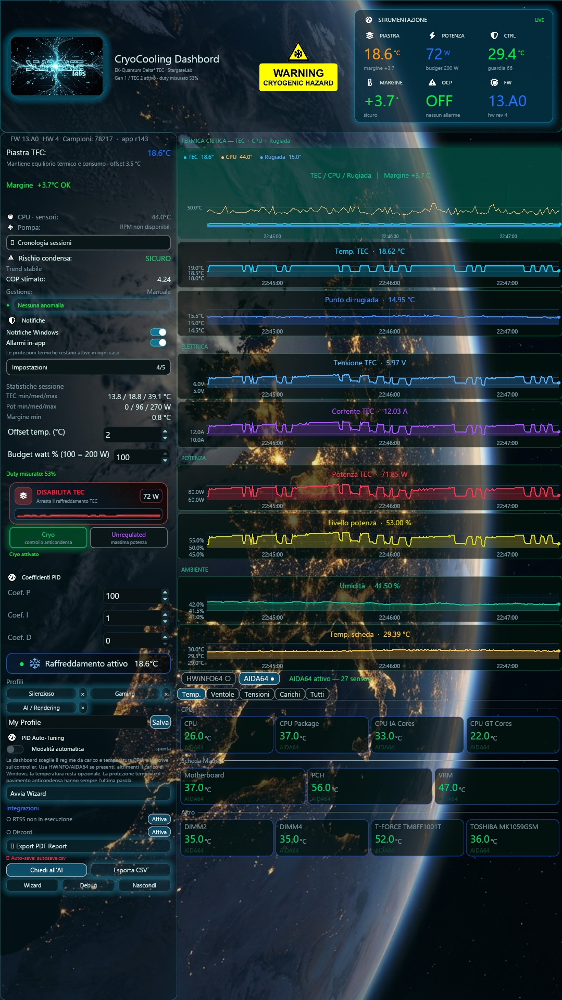

<p align="center"></p>

<p align="center"> &nbsp;  &nbsp; </p>

# StargateCryo · Intel Cryo Cooling Dashboard

[Italiano](README.md) · [English](README.en.md) · [Release](https://github.com/StargateLabs/dashboard-for-intel-cryo-cooling-technology/releases) · [Changelog](CHANGELOG.md)

An independent Rust dashboard for monitoring and controlling Intel Cryo controllers through their serial protocol. It combines regulation, telemetry, diagnostics and session history. The protocol is documented through reverse engineering; Intel software is not redistributed.

## Updated desktop release

Release v2.9.0 includes the 23 October desktop build: TF2/TF3, current Core Temp clocks, chart-cache optimizations and corrected diagnostics. The executable retains its R16 filename and internal version 2.5.0. See the notes for the relationship between tag, source and binary.

[Update notes](docs/releases/DESKTOP-UPDATE-EN.md) · [SHA256 / provenance](docs/releases/desktop-2026-10-23.json)

## Capabilities

- Controller telemetry: temperatures, measured power, PID state, condensation margin and diagnostics.
- Cooling-loop charts and Thermaltake TF2/TF3 readings with timeouts and explicit unavailable states.
- Current CPU clock from Core Temp; sensor panel with documented data sources.
- Profiles, configuration, history, reporting and recovery supervisor.

## Installation and update

Download the executable and SHA256 file from the release. Verify the checksum using `Get-FileHash`. Before replacing an earlier version, back up configuration and data; exit through the application’s Exit command and verify control has stopped. Do not run competing programs on the same serial port. Retain the previous build for rollback.

TF2 integration while SignalRGB is running requires the compatible plugin publishing fresh log samples. Without it the value remains unavailable; no flow measurement is fabricated.

## Build and verification

```powershell
cargo test --workspace
cargo build --release
```

Windows requires Rust MSVC and Visual Studio C++ Build Tools. Dependencies are recorded in Cargo.lock. Publication checks are documented in [PUBLICATION-VERIFICATION.md](docs/releases/PUBLICATION-VERIFICATION.md).

## Compatibility and limits

The program does not enforce a CPU-model allowlist. Cooling hardware must still meet the mounting, electrical and thermal requirements of the actual setup. Documented validation concerns a modified Gen 1 controller with a Gen 2 TEC assembly, not certification of other systems. Software thresholds and estimated COP do not replace hardware characterization.

The opening screenshot is from an earlier build and is retained as hardware documentation; it is not presented as an image of the updated interface.

## Documentation

- [Reverse engineering](docs/reverse-engineering/cryo-gen1.md)
- [Changelog](CHANGELOG.md)
- [Security](SECURITY.md) · [Trademarks](TRADEMARKS.md) · [License](LICENSE)
- [Archivio tecnico precedente / Previous technical overview](docs/archive/README-before-desktop-update.md)
- [Stargate Labs](https://github.com/StargateLabs) · [Portfolio](https://stargatelabs.github.io/StargateLabs/)

<sub>Independent software. Intel, EK and Thermaltake trademarks belong to their respective owners.</sub>
