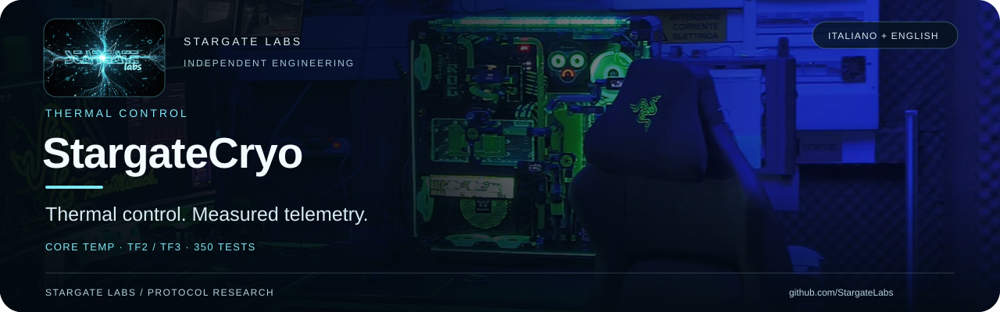
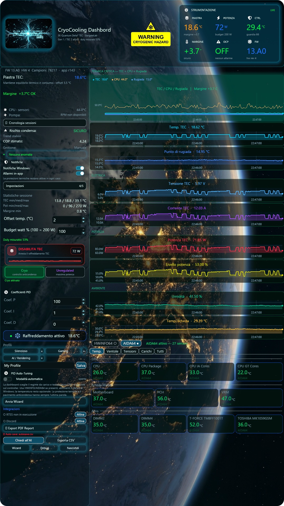

<p align="center"></p>

<p align="center"> &nbsp;  &nbsp; </p>

# StargateCryo · Intel Cryo Cooling Dashboard

[Italiano](README.md) · [English](README.en.md) · [Release](https://github.com/StargateLabs/dashboard-for-intel-cryo-cooling-technology/releases) · [Changelog](CHANGELOG.md)

Dashboard indipendente per monitorare e controllare controller Intel Cryo tramite il protocollo seriale. Sviluppata in Rust, integra regolazione, telemetria, diagnostica e storico delle sessioni. Il protocollo è documentato tramite reverse engineering; il software Intel non viene redistribuito.

## Versione desktop aggiornata

La release v2.9.0 include la build desktop del 23 ottobre: TF2/TF3, clock Core Temp corrente, ottimizzazioni della cache grafica e diagnostica corretta. L’eseguibile conserva il nome R16 e la versione interna 2.5.0. Consulta le note per la relazione fra tag, sorgenti e binario.

[Note aggiornamento](docs/releases/DESKTOP-UPDATE-IT.md) · [SHA256 / provenance](docs/releases/desktop-2026-10-23.json)

## Funzioni

- Telemetria del controller: temperature, potenza misurata, stato PID, margine di condensa e diagnostica.
- Grafici del circuito e letture Thermaltake TF2/TF3, con timeout e segnalazione N/D.
- Clock CPU corrente da Core Temp; pannello sensori e fonti documentate.
- Profili, configurazione, storico, report e supervisore di recupero.

## Installazione e aggiornamento

Scarica l’eseguibile e il file SHA256 dalla release. Verifica il checksum con `Get-FileHash`. Prima di sostituire una versione precedente, salva configurazione e dati; chiudi la dashboard tramite il comando Esci e verifica la conclusione del controllo. Non avviare due programmi sulla stessa porta seriale. Conserva la build precedente per il ripristino.

Per TF2 con SignalRGB attivo serve il plugin compatibile che pubblica campioni freschi nel log. Senza quel plugin il valore resta N/D: non viene inventata una portata.

## Compilazione e verifiche

```powershell
cargo test --workspace
cargo build --release
```

Windows richiede toolchain Rust MSVC e Visual Studio Build Tools C++. Le dipendenze sono fissate in Cargo.lock. Per le prove di pubblicazione consulta [PUBLICATION-VERIFICATION.md](docs/releases/PUBLICATION-VERIFICATION.md).

## Compatibilità e limiti

Il programma non applica un elenco di modelli CPU consentiti. Il sistema di raffreddamento deve comunque essere compatibile con il montaggio e con i limiti elettrici e termici del proprio impianto. Il collaudo descritto riguarda un controller Gen 1 modificato con TEC Gen 2; non certifica altri impianti. Le soglie software e il COP stimato non sostituiscono una caratterizzazione hardware.

Lo screenshot in apertura appartiene a una build precedente ed è conservato come documentazione del dispositivo; non viene presentato come immagine della nuova interfaccia.

<p align="center"></p>

## Documentazione

- [Reverse engineering](docs/reverse-engineering/cryo-gen1.md)
- [Changelog](CHANGELOG.md)
- [Security](SECURITY.md) · [Trademarks](TRADEMARKS.md) · [License](LICENSE)
- [Archivio tecnico precedente / Previous technical overview](docs/archive/README-before-desktop-update.md)
- [Stargate Labs](https://github.com/StargateLabs) · [Portfolio](https://stargatelabs.github.io/StargateLabs/)

<sub>Independent software. Intel, EK and Thermaltake trademarks belong to their respective owners.</sub>
